# 📦 StockFlow — Sistem Inventaris & Penjualan (Laravel 13)

Aplikasi web **Inventaris & Penjualan** untuk UMKM: mengelola barang, kategori, supplier, gudang, pembelian (stok masuk), penjualan kasir, pesanan online pelanggan, pembukuan otomatis, laporan, serta integrasi (REST API, webhook). Dibuat untuk UTS *Integrated Laravel Project* — Sistem Informasi, Universitas Malikussaleh.

Tiga peran pengguna: **Admin**, **Staff**, dan **Pelanggan**. Seluruh antarmuka berbahasa Indonesia.

---

## 0. Upgrade "StockFlow Blue" (ringkasan)

**Tampilan:** palet biru (#1769E0 / navy #12315A), kartu membulat, sidebar desktop + navigasi bawah mobile, header dengan pencarian/notifikasi/profil, tema terang & gelap, skeleton, toast, dialog konfirmasi ala iOS, breadcrumb, empty state, halaman error ramah.

**Dashboard:** kartu statistik dari data nyata (produk aktif, total stok, nilai persediaan, penjualan, pembelian, stok menipis/habis, transaksi terbaru, aktivitas pengguna, performa gudang) dengan pembanding periode atau "Belum cukup data". Tiga grafik prioritas di dashboard; analitik lanjutan (nilai persediaan, komposisi kategori, performa supplier, pergerakan per gudang) di halaman **Analitik**, selalu dengan tabel data.

**Otomasi berbasis aturan (bukan AI):** peringatan stok menipis · rekomendasi restock (dengan alasan & dasar perhitungan) · deteksi anomali (hanya menandai, tidak menghapus) · kedaluwarsa/batch/FEFO · pencarian pintar + scan barcode kamera · notifikasi terpusat · stock opname dengan persetujuan · pengingat pembelian per supplier → draft PO → persetujuan · laporan otomatis (CSV/Excel).

**Inti stok:** satu titik perubahan stok (`StockService`) dengan kartu stok, batch, transaksi DB, dan kunci idempotensi (`request_key`) sehingga klik ganda tidak menggandakan transaksi. Alur PO: draft → diajukan → disetujui → diterima sebagian/penuh. Retur penjualan dengan aturan jelas. Transfer gudang dengan persetujuan untuk jumlah besar.

**Role:** tetap 3 role (Admin, Staff, Pelanggan). Peran *Staff Gudang* dan *Kasir* digabung dalam role **Staff**; otorisasi ada di backend (Gate + middleware).

Lihat `PANDUAN-INSTALASI.md` untuk instalasi (termasuk `Jalankan-StockFlow.bat`) dan pemecahan masalah.

### Yang selesai vs. terbatas (jujur)
- Selesai & dites otomatis (172 tes): semua fitur inti di atas.
- **Tampilan belum diuji di peramban/dibangun di lingkungan pengembangan ini** (registry npm tidak terjangkau). Tes memverifikasi HTML server-side; jalankan `npm install && npm run build` lalu periksa visual di komputer Anda.
- Pembayaran adalah **simulasi**; mata uang hanya tampilan; prediksi stok bersifat statistik sederhana; aplikasi seluler berupa PWA (bukan native); notifikasi hanya internal (tanpa email/eksternal).

---

## 1. Gambaran Umum

| Aspek | Keterangan |
| --- | --- |
| Framework | Laravel 13.x, PHP 8.4+ |
| Frontend | Blade + Tailwind CSS + Alpine.js, Chart.js (grafik) |
| Auth | Laravel Breeze (session) + role-based access (Gate + middleware) |
| Database | SQLite bawaan (file demo disertakan); MySQL/MariaDB didukung lewat `.env` |
| Ekspor | PDF (dompdf), Excel (maatwebsite/excel) |
| Pengujian | PHPUnit — 150 tes feature/unit |

### Fitur wajib (sesuai soal)
Autentikasi · role-based access · CRUD kategori/barang/supplier · pembelian (stok masuk) · penjualan · stok otomatis · pencarian/filter/pagination · dashboard · validasi.

### Fitur tambahan ("tidak wajib" pada soal, tetap dibuat)
| Fitur | Cara kerjanya | Batasan jujur |
| --- | --- | --- |
| Payment gateway | Antarmuka `PaymentGateway` + `SimulatedPaymentGateway`; webhook pembayaran bertanda tangan HMAC-SHA256 | **Simulasi** — tidak ada uang nyata. Kartu berakhiran `0000` selalu ditolak untuk demo |
| Multi-gudang | Tabel `warehouses` + `warehouse_stocks`, transfer stok antar gudang | `barangs.stock` = jumlah seluruh gudang (dijaga `StockService`) |
| Akuntansi sederhana | Jurnal double-entry otomatis (penjualan, pembelian, pelunasan, beban, penyesuaian stok), laba-rugi, neraca saldo, buku besar | Bukan akuntansi lengkap (tanpa pajak, aset tetap, penutupan periode) |
| Aplikasi mobile | REST API `/api/v1` (token Bearer) + aplikasi web **PWA** (bisa di-install, manifest + service worker) | Tidak ada aplikasi native Android/iOS |
| Prediksi stok | Regresi linear atas penjualan mingguan → prediksi permintaan & saran pembelian ulang | **Statistik sederhana, bukan AI/ML**; transparan dan diuji |
| Integrasi ERP | API baca-saja `/api/erp/v1` (API key bertipe `erp`) + webhook keluar bertanda tangan | Tidak terhubung ke ERP tertentu; kontrak API generik |
| Multi-currency | Pilihan mata uang tampilan (IDR, USD, SGD, MYR, EUR), kurs diatur admin | **Hanya tampilan**; semua data tersimpan dalam IDR |

---

## 2. Kebutuhan Sistem

- PHP **8.4+** (proyek tidak menyertakan file kunci paket, jadi `composer install` memilih versi yang cocok dengan PHP Anda; ekstensi: mbstring, xml, curl, zip, gd, pdo_mysql / pdo_sqlite)
- Composer 2
- Node.js 20+ dan npm (untuk build Vite)
- MySQL 8 / MariaDB 10.6+ (atau SQLite)

## 3. Instalasi

```bash
git clone <url-repo-anda> stockflow
cd stockflow

composer install
npm install

cp .env.example .env
php artisan key:generate
```

### Konfigurasi `.env`
```dotenv
APP_NAME=StockFlow
APP_URL=http://localhost:8000
APP_LOCALE=id

# MySQL
DB_CONNECTION=mysql
DB_HOST=127.0.0.1
DB_PORT=3306
DB_DATABASE=stockflow
DB_USERNAME=root
DB_PASSWORD=

# Pembayaran (simulasi). Isi secret acak agar endpoint webhook pembayaran aktif.
PAYMENT_DRIVER=simulated
PAYMENT_WEBHOOK_SECRET=
```
> Hanya `.env.example` yang boleh di-commit. Jangan pernah meng-commit `.env` atau kredensial asli.
> Bawaan: SQLite dengan file `database/database.sqlite` yang sudah berisi data demo (`.env.example` memakai `DB_CONNECTION=sqlite`). Blok MySQL di atas dipakai bila Anda memilih MySQL.

### Migrasi & seeding
```bash
php artisan migrate --seed      # atau: php artisan migrate:fresh --seed
php artisan storage:link
npm run build                   # atau `npm run dev` saat pengembangan
php artisan serve
```
Buka `http://127.0.0.1:8000`.

### Akun demo (password semua: `password`)
| Role | Email | Keterangan |
| --- | --- | --- |
| Admin | `admin@inventory.test` | Akses penuh |
| Staff | `staff@inventory.test` | Gudang & kasir |
| Staff | `kasir@inventory.test` | Contoh staff kedua (tiap staff hanya melihat penjualan kasir miliknya) |
| Pelanggan | `pelanggan@inventory.test` | Belanja online |
| Pelanggan | `siti@inventory.test`, `rahmat@inventory.test` | Pelanggan tambahan |

Seeder membuat data realistis (kategori, supplier, barang, 2 gudang, pembelian, penjualan, pesanan pending, pengeluaran, jurnal) melalui **service yang sama dengan aplikasi**, sehingga stok dan pembukuan konsisten. Data seluruhnya dummy.

---

## 4. Fitur per Peran & Matriks Hak Akses

| Fitur | Admin | Staff | Pelanggan |
| --- | :-: | :-: | :-: |
| Dashboard internal (omzet, stok menipis, tren 6 bulan, produk terlaris) | ✅ | ✅ | — |
| Dashboard pelanggan (ringkasan pesanan) | — | — | ✅ |
| Katalog, keranjang, checkout, pembayaran (simulasi), batalkan pesanan *pending* | — | — | ✅ |
| Lihat pesanan milik sendiri | — | — | ✅ (hanya miliknya) |
| Lihat daftar & detail barang, stok menipis, ekspor PDF/Excel | ✅ | ✅ | — |
| Tambah/ubah/hapus barang, kategori, supplier | ✅ | — | — |
| Pembelian (stok masuk) | ✅ buat + batalkan | ✅ buat | — |
| Penjualan kasir (POS) & proses pesanan online | ✅ | ✅ | — |
| Batalkan penjualan | ✅ semua yang belum batal | ✅ hanya *pending* dalam cakupannya | ✅ hanya pesanan *pending* miliknya |
| Tandai lunas / pembayaran | ✅ | ✅ | ✅ (pesanannya) |
| Penyesuaian stok, transfer antar gudang, prediksi stok, riwayat transaksi | ✅ | ✅ | — |
| Kelola pengguna & gudang | ✅ | — | — |
| Laporan (penjualan, laba-rugi, neraca saldo, buku besar, jurnal) | ✅ | — | — |
| Pengeluaran, mata uang, integrasi (webhook, API key) | ✅ | — | — |
| Invoice PDF | ✅ | ✅ (cakupannya) | ✅ (miliknya) |

Cakupan data: Admin melihat semua; Staff melihat penjualan kasir miliknya + semua pesanan online; Pelanggan hanya miliknya (`Sale::visibleTo`). Aturan ditegakkan **di server** (Gate, middleware `role:`, `authorize()` di FormRequest), bukan hanya disembunyikan di tampilan.

---

## 5. Aturan Bisnis

1. **SKU/kode barang unik**; kode dibuat otomatis (tidak bisa bentrok, juga dengan barang yang sudah di-soft-delete).
2. **Penjualan tidak boleh melebihi stok** — ditolak dengan pesan jelas; stok tidak pernah negatif (dijaga di validasi *dan* di `StockService`).
3. **Total dihitung di server** dari harga di database. `unit_price`/`total` kiriman browser diabaikan.
4. **Database transaction + row lock** (`lockForUpdate`) pada semua operasi stok. Jika satu item gagal, seluruh transaksi di-*rollback* (stok, header, detail, jurnal).
5. **Baris item ganda digabung** sebelum cek stok (tidak bisa mengakali dengan memecah qty).
6. **Pembatalan mengembalikan stok** dan membalik jurnal; pembatalan dua kali tidak mengembalikan stok dua kali.
7. **Pembelian yang stoknya sudah terpakai tidak bisa dibatalkan.**
8. **Barang dengan transaksi tidak dihapus permanen** — memakai *soft delete*; barang dengan stok > 0 tidak bisa dihapus. Kategori/supplier yang masih terpakai tidak bisa dihapus.
9. **Pesanan pelanggan** berstatus *pending* tanpa memotong stok; stok baru berkurang saat staff memproses (*complete*).
10. **Nomor dokumen** diturunkan dari primary key (`SL-`, `PB-`, `TF-`, `JE-`), bebas bentrok walau transaksi bersamaan.
11. **Jurnal selalu seimbang** (debit = kredit); jurnal tidak dihapus, hanya dibalik.
12. **Role tidak bisa diubah lewat mass-assignment** (`role` tidak ada di `$fillable`; hanya admin yang mengubahnya lewat halaman pengguna).

---

## 6. ERD

```mermaid
erDiagram
    users ||--o{ sales : "kasir (user_id)"
    users ||--o{ sales : "pelanggan (customer_id)"
    users ||--o{ purchases : mencatat
    users ||--o{ api_tokens : memiliki
    categories ||--o{ barangs : mengelompokkan
    suppliers ||--o{ barangs : memasok
    suppliers ||--o{ purchases : menerima
    warehouses ||--o{ warehouse_stocks : menyimpan
    barangs ||--o{ warehouse_stocks : "stok per gudang"
    purchases ||--|{ purchase_items : berisi
    barangs ||--o{ purchase_items : dibeli
    sales ||--|{ sale_items : berisi
    barangs ||--o{ sale_items : dijual
    warehouses ||--o{ purchases : tujuan
    warehouses ||--o{ sales : sumber
    warehouses ||--o{ stock_transfers : "asal/tujuan"
    barangs ||--o{ stock_transfers : dipindah
    journal_entries ||--|{ journal_lines : berisi
    accounts ||--o{ journal_lines : dicatat
    webhook_endpoints ||--o{ webhook_deliveries : mengirim

    users { bigint id PK
            string name
            string email UK
            string role "admin|staff|pelanggan"
            string phone
            string address }
    categories { bigint id PK
                 string name
                 string slug UK }
    suppliers { bigint id PK
                string name
                string phone
                string email }
    barangs { bigint id PK
              bigint category_id FK
              bigint supplier_id FK
              string code UK "SKU"
              string name
              int purchase_price
              int selling_price
              int stock
              int minimum_stock
              bool is_active
              timestamp deleted_at "soft delete" }
    warehouses { bigint id PK
                 string code UK
                 string name
                 bool is_default }
    warehouse_stocks { bigint warehouse_id FK
                       bigint barang_id FK
                       int quantity }
    purchases { bigint id PK
                string purchase_number UK
                bigint supplier_id FK
                bigint user_id FK
                bigint warehouse_id FK
                int total
                string status }
    purchase_items { bigint purchase_id FK
                     bigint barang_id FK
                     int quantity
                     int unit_cost
                     int subtotal }
    sales { bigint id PK
            string sale_number UK
            bigint user_id FK
            bigint customer_id FK
            bigint warehouse_id FK
            string channel "pos|online"
            int total
            string status "pending|completed|cancelled"
            string payment_status }
    sale_items { bigint sale_id FK
                 bigint barang_id FK
                 int quantity
                 int unit_price
                 int unit_cost
                 int subtotal }
    stock_transfers { bigint id PK
                      string transfer_number UK
                      bigint from_warehouse_id FK
                      bigint to_warehouse_id FK
                      bigint barang_id FK
                      int quantity }
    accounts { bigint id PK
               string code UK
               string name
               string type }
    journal_entries { bigint id PK
                      string entry_number UK
                      date entry_date
                      string reference_type
                      bigint reference_id
                      timestamp reversed_at }
    journal_lines { bigint journal_entry_id FK
                    bigint account_id FK
                    int debit
                    int credit }
    expenses { bigint id PK
               date expense_date
               string title
               int amount }
    currencies { string code UK
                 int decimals
                 float rate
                 bool is_base }
    api_tokens { bigint user_id FK
                 string token "hash sha256"
                 string type "mobile|erp" }
    webhook_endpoints { string url
                        string secret
                        json events }
    webhook_deliveries { bigint webhook_endpoint_id FK
                         string event
                         int response_status }
```



Tabel `stock_outs` dipertahankan untuk **penyesuaian stok** (barang rusak/hilang/pemakaian internal). Penjualan memakai `sales` + `sale_items`, pembelian memakai `purchases` + `purchase_items`.

### Relasi Eloquent utama
- `Category hasMany Barang`, `Supplier hasMany Barang`, `Barang belongsTo Category/Supplier`
- `Barang hasMany WarehouseStock`, `Warehouse hasMany WarehouseStock`
- `Purchase belongsTo Supplier/User/Warehouse`, `Purchase hasMany PurchaseItem`
- `Sale belongsTo User (kasir) / customer (User) / Warehouse`, `Sale hasMany SaleItem`
- `SaleItem/PurchaseItem belongsTo Barang`
- `JournalEntry hasMany JournalLine`, `JournalEntry morphTo reference`
- `User hasMany sales/orders/purchases/apiTokens`

---

## 7. Arsitektur

```
app/
├── Http/Controllers/        # tipis: validasi → panggil service → redirect/respons
│   ├── Admin/               # Pengguna, Gudang, Laporan, Pengeluaran, Mata uang, Integrasi
│   ├── Api/                 # REST API (mobile & ERP) + webhook pembayaran
│   └── Shop/                # Katalog, keranjang, pesanan pelanggan
├── Http/Middleware/         # CheckRole, AuthenticateApiToken, EnsureInternalUser
├── Http/Requests/           # FormRequest: validasi + authorize()
├── Models/                  # Eloquent + scope (visibleTo, active, lowStock, search)
├── Services/                # LOGIKA BISNIS
│   ├── StockService         # satu-satunya pintu perubahan stok (lock + konsistensi)
│   ├── SaleService          # POS, pesanan online, proses, batal, lunas
│   ├── PurchaseService      # pembelian & pembatalan
│   ├── StockTransferService / StockAdjustmentService
│   ├── JournalService       # jurnal double-entry & pembalikan
│   ├── PaymentService + Payment/*   # gateway (simulasi)
│   ├── WebhookDispatcher    # webhook keluar bertanda tangan
│   ├── ForecastService      # regresi linear
│   └── CurrencyService      # konversi tampilan
├── Exceptions/              # InsufficientStockException, BusinessRuleException
└── Helpers/helpers.php      # money()
```

Keamanan: CSRF (semua form web), `@csrf` + validasi server, Gate & middleware role, *mass-assignment* dibatasi (`$fillable`), token API disimpan sebagai hash sha256, webhook ditandatangani HMAC-SHA256 dan dibandingkan dengan `hash_equals`, rate limiting pada login/API, URL webhook hanya `http(s)`.

---

## 8. REST API

Autentikasi: `Authorization: Bearer <id|secret>`.

| Endpoint | Keterangan |
| --- | --- |
| `POST /api/v1/login` | `email`, `password` → token (30 hari) |
| `GET /api/v1/me`, `POST /api/v1/logout` | profil / cabut token |
| `GET /api/v1/products`, `/products/{id}`, `/categories` | katalog |
| `GET/POST /api/v1/orders`, `GET /orders/{id}`, `POST /orders/{id}/cancel` | pesanan (hanya **pelanggan** yang boleh membuat; hanya milik sendiri) |
| `GET /api/v1/dashboard` | ringkasan (admin/staff) |
| `GET /api/erp/v1/products\|sales\|purchases` | token bertipe `erp` milik admin; `?updated_since=ISO8601` |
| `POST /api/payments/webhook` | header `X-Signature = HMAC-SHA256(body, PAYMENT_WEBHOOK_SECRET)` |

Webhook keluar (dikonfigurasi admin di menu **Integrasi**): event `sale.completed`, `sale.cancelled`, `purchase.completed`, `purchase.cancelled`, `stock.low`; header `X-StockFlow-Event` dan `X-StockFlow-Signature: sha256=<hmac>`. Kegagalan pengiriman dicatat dan **tidak** menggagalkan transaksi.

---

## 9. Pengujian

```bash
php artisan test
```
150 tes (PHPUnit, SQLite in-memory) meliputi: autentikasi, matriks role per halaman, CRUD master, validasi, stok tidak boleh melebihi, atomicity/rollback, pembatalan & pemulihan stok, alur pesanan online, jurnal seimbang & pembalikan, laba-rugi, pembayaran simulasi & webhook HMAC, REST API (token, role, isolasi data), transfer gudang, regresi/prediksi, konversi mata uang, dan webhook keluar (`Http::fake`).

---

## 10. Screenshot

Letakkan tangkapan layar pada `docs/screenshots/` lalu rujuk di sini: login, dashboard admin, daftar barang, form penjualan kasir, katalog pelanggan, detail pesanan + pembayaran, laporan laba-rugi, halaman integrasi.

## 11. Batasan yang Diketahui (Known Limitations)

- **Payment gateway hanya simulasi**; belum ada integrasi penyedia pembayaran sungguhan.
- **Prediksi stok = regresi linear sederhana**, bukan AI/ML; akurasi terbatas pada pola tren linear dan data historis yang cukup.
- **Multi-currency hanya tampilan**; kurs diisi manual, transaksi tetap IDR.
- **Aplikasi mobile berupa PWA + REST API**, bukan aplikasi native.
- **Akuntansi disederhanakan** (tanpa pajak/aset tetap/penutupan periode); metode HPP memakai harga beli barang saat transaksi.
- **Multi-gudang** tanpa pelacakan lot/batch/kedaluwarsa.
- Tidak ada antrian (queue) untuk webhook; pengiriman sinkron dengan timeout 5 detik.
- Email (reset password) memerlukan konfigurasi `MAIL_*`.

## 12. Lisensi
Proyek ini dibuat untuk keperluan pembelajaran (UTS). Seluruh data adalah data dummy.
